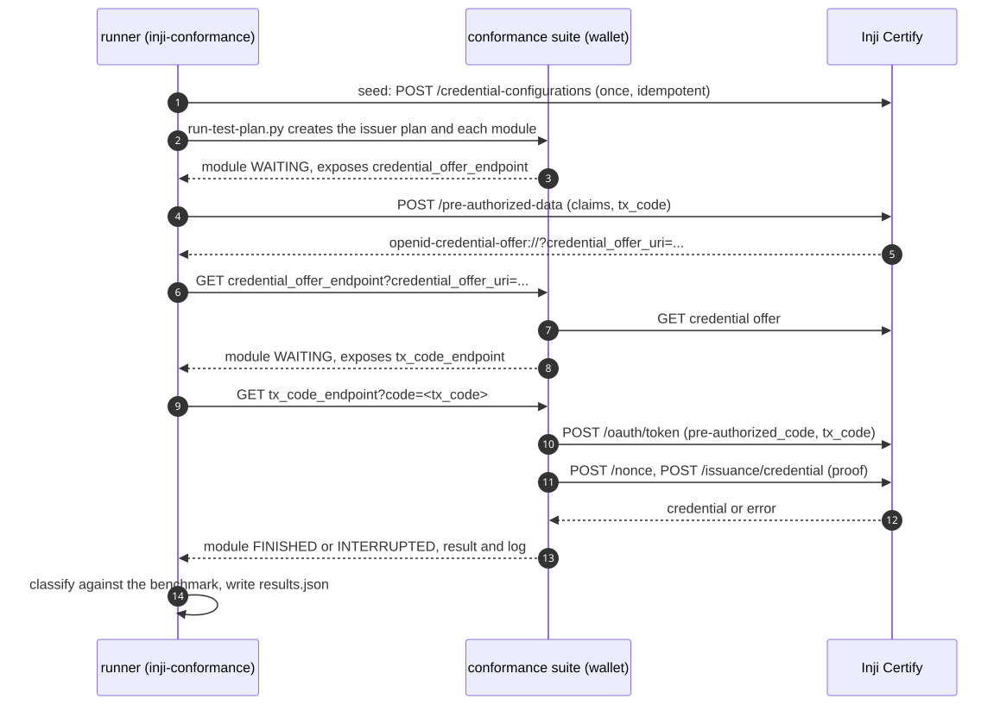
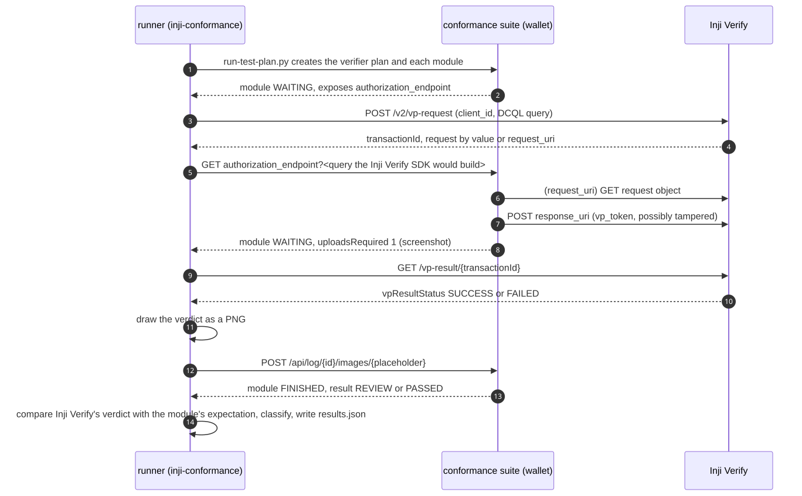

# Architecture

How the harness tests Inji Certify and Inji Verify with the OpenID Foundation conformance suite, without a person
in the loop. Diagrams are Mermaid sources in [diagrams/](diagrams/) with the rendered SVG next to them.

## Components

| Part | Where | Job |
|---|---|---|
| Conformance suite | `suite-server`, `suite-mongodb`, `suite-nginx` (release-v5.3.1, pinned digests) | Plays the wallet against both Inji components; runs the OpenID4VCI 1.0 issuer plan and the OpenID4VP 1.0 verifier plan |
| Inji Certify | `certify` + `certify-db` | System under test: issuer and its own authorization server (pre-authorized code flow) |
| Inji Verify | `verify-service` + `verify-db` | System under test: verifier backend (the Inji Verify UI is not needed) |
| TLS proxy | `tls-proxy` (nginx) | HTTPS names `certify.inji.test:18450` and `verify.inji.test:18451` with the run's test CA; the suite rejects plain HTTP |
| pki-init | one-shot Python container | Test CA, TLS certificates, the suite's mTLS client and credential signing keys, Inji Verify's request signing keystore |
| Runner | `runner` image, `inji-conformance` | Drives the suite's own `run-test-plan.py`, answers every handoff, classifies results, writes `results.json` |
| Testrig | `testrigs/` image | The Inji api-testrigs with an `OpenIDConformanceTest` TestNG class per component; uploads the `EmailableReport` to MinIO |
| MinIO | `minio` (profile `reports`) | The S3 store the api-testrigs upload to (bucket `automationtests`) |
| Entry scripts | `run-conformance.sh`, `run-full-stack-conformance.sh`, `scripts/dc.sh` | Preflight, compose, run, testrig step, report, teardown |

Everything runs on one Docker network (`inji-conformance_default`). The `*.inji.test` names exist only there, so every
caller of Inji (runner, testrig, `probe`) runs in a container. Host ports are bound to 127.0.0.1 only
([configuration.md](configuration.md)).

## One issuer module

The suite waits twice per flow: for a credential offer, then for the transaction code a person would type. The
runner creates a fresh pre-authorized offer at Inji Certify for each, so single-use codes never collide
([handoffs.md](handoffs.md)).

## One verifier module

The runner builds the authorization request exactly as the Inji Verify SDK does, so the suite sees what a real
wallet would see. When a module needs a person to look at the verifier's result screen (result REVIEW), the runner
reads Inji Verify's verdict from its API and uploads an image of it into the suite's placeholder.

## The user's view

## Design decisions

| Decision | Why | Alternative not taken |
|---|---|---|
| Reuse the suite's `run-test-plan.py` unchanged (vendored, MIT) for plan creation, module order and its expected-failures analysis | It is what the OpenID Foundation's own CI runs; the benchmark files are its format, and the runner cross-checks its gate against the script's exit code | A new plan driver: more code, and a second interpretation of the suite's results |
| A responder thread answers every WAITING state through the suite's REST API | No browser or person; the same code serves both components | Selenium on the suite's web pages |
| One verdict per module, computed once by the runner (`results.json` v1) | The gate, the HTML report and the TestNG rows can never disagree | Each reader classifying for itself |
| Benchmark of expected failures with owner, spec clause and finding per entry | Every accepted failure is explained and traceable; a new failure fails the build; a fixed one makes the entry stale | A pass-rate threshold, which hides new failures behind old ones |
| INTERRUPTED with result FAILED and a logged failure is judged like FAILED | Inji Certify's failures inside a request the suite answers interrupt the module; `run-test-plan.py` analyses such modules the same way | Treating them as harness errors, which would make every Certify failure a regression |
| The TLS proxy may add `authorization_endpoint` to Certify's OAuth metadata (default on, marked in `results.json`) | Without it the suite stops every issuer flow at its first condition, and nothing about issuance can be measured ([finding](findings/certify-as-metadata-authorization-endpoint.md)) | Stopping at that finding |
| The default verifier configuration uses a `redirect_uri` client id | It reaches the presentation checks; the `x509_san_dns` configuration stops at the request object signature ([finding](findings/verify-request-signing-eddsa-only.md)) and stays available with `--template` | Only `x509_san_dns` |
| Plans of both components run in parallel, modules inside a plan serially | The suite runs a configuration with an alias one module at a time; two aliases run side by side | Sharding a plan across several suite plans |
| Run-time keys only, generated per run folder | Nothing secret in git; the suite's exports (which contain the configuration's private keys) are never committed | Committed test keys |
